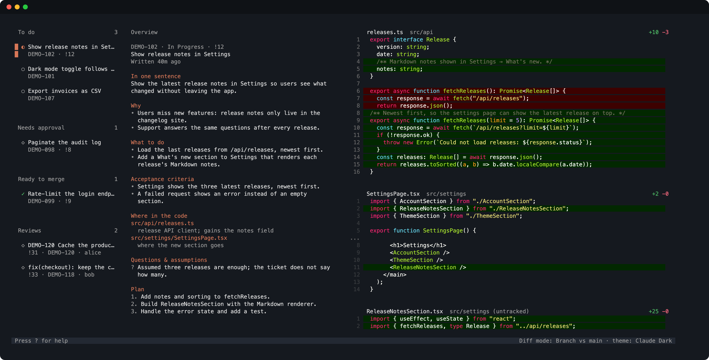

# flow



**Everything you need to work, in one place.** Your tickets, your squad's reviews, the code, and Claude, side by side in one terminal: no more jumping between YouTrack, GitLab, Notion, and Slack.

flow closes the context gap: Claude starts every ticket already knowing it, and everything around the code runs itself. What's left is the part that matters, a human–AI loop on the code:

```text
full context  →  Claude writes  →  you review  →  Claude improves  →  shipped
```

## How it works

- **Zero-prompt context.** Pick a ticket and Claude has read it, its Notion pages, and every comment.
- **Overview.** See what Claude understood before it writes a line. The ticket and docs stay the source of truth.
- **Ticket-vs-code review.** `R` checks the code against the ticket's acceptance criteria, not just for bugs.
- **Inline loop.** Comment a hunk; Claude fixes it and replies in place.
- **Delivery without leaving it.** Branch, commits, merge request, Slack ping, and ticket state, one key each, and merged tickets close themselves. You just approve.

## Quick start

```bash
git clone https://github.com/JuanBernal98/flow.git
cd flow && ./install.sh     # first install: flow + Claude Code, asking before each step
cd ~/code/your-repo
flow init                   # connect the repo to your YouTrack, GitLab, and Slack
flow diff                   # open flow; run `claude` in another terminal
```

Needs macOS or Linux, Git, [bun](https://bun.sh), and [Claude Code](https://claude.com/claude-code). Update later with `flow update`.

## A ticket, start to finish

```text
S  Enter   # pick a ticket: branch ready, Claude reads the ticket
x          # check what Claude understood
           # build it with Claude; the diff updates live
a          # comment a hunk: Claude fixes it inline
R          # review the code against the ticket
C          # commit (you confirm the messages)
P          # push, open the MR, ping your squad
```

Reviewing a teammate's MR works the same: pick it under **Reviews**, `Enter`, `R`. Press `?` for every key.

## Good to know

- **Nothing leaves without you.** Commits, pushes, MRs, and Slack posts wait for your yes.
- **No company details in flow.** Each squad's YouTrack, GitLab label, and Slack channel live in a local `.flow/config.toml`.
- **Idle costs nothing.** flow and Claude talk through files in `.flow/`; no daemon, no tokens while you work.

Built on [dunk](https://github.com/amix/dunk)'s diff viewer. Development notes in [`AGENTS.md`](AGENTS.md). [MIT](LICENSE).
