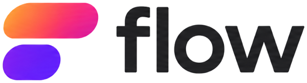
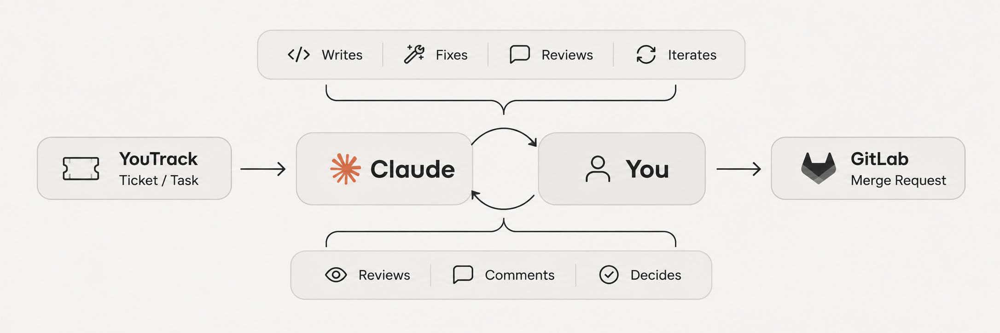

<div align="center">

<picture>
  <source media="(prefers-color-scheme: dark)" srcset="assets/flow-logo-dark.png">
  
</picture>

### Everything you need to work, in one place, with zero-prompt context for Claude.

Your tickets, your squad's reviews, the code, and Claude, side by side in one terminal:<br>
no more jumping between YouTrack, GitLab, Notion, and Slack.

<br>


[How it works](#how-it-works) · [Quick start](#quick-start) · [From ticket to merge request](#from-ticket-to-merge-request) · [Good to know](#good-to-know)

</div>

<br>


## How it works

**flow** minimizes distractions and leaves only what matters: review, iteration, and judgment, in a human–AI loop. Claude starts every ticket already knowing it, and everything around the code runs itself:

<p align="center">
  
</p>

<table>
  <tr>
    <td width="33%" valign="top">
      <b>Native Claude</b><br>
      Claude Code runs in its own terminal, as always. One session, full context, no gaps.
    </td>
    <td width="33%" valign="top">
      <b>Zero-prompt context</b><br>
      Claude already knows the ticket. You never paste context again.
    </td>
    <td width="33%" valign="top">
      <b>Overview</b><br>
      See what Claude understood, before a single line is written.
    </td>
  </tr>
  <tr>
    <td valign="top">
      <b>Ticket-vs-code review</b><br>
      Not just "does it work?", but "is it what the ticket asked?"
    </td>
    <td valign="top">
      <b>Inline loop</b><br>
      Talk to Claude right on the code. Every round, better.
    </td>
    <td valign="top">
      <b>Automate the busywork</b><br>
      Ticket updates, commits, merge requests, Slack team updates. All from one place.
    </td>
  </tr>
</table>

## Quick start

```bash
git clone https://github.com/JuanBernal98/flow.git
cd flow && ./install.sh     # first install: flow + Claude Code, asking before each step
cd ~/code/your-repo
flow init                   # connect the repo to your YouTrack, GitLab, and Slack
flow                        # open flow; run `claude` in another terminal
```

> [!NOTE]
> Needs macOS or Linux, Git, [bun](https://bun.sh), and [Claude Code](https://claude.com/claude-code). To update, `git pull` in the flow folder; flow tells you if you need to run `flow setup`.

## From ticket to merge request

<table>
  <tr>
    <td width="14%" align="center"><kbd>S</kbd> <kbd>Enter</kbd></td>
    <td width="14%" align="center"><kbd>x</kbd></td>
    <td width="14%" align="center">…</td>
    <td width="14%" align="center"><kbd>a</kbd></td>
    <td width="14%" align="center"><kbd>R</kbd></td>
    <td width="14%" align="center"><kbd>C</kbd></td>
    <td width="14%" align="center"><kbd>P</kbd></td>
  </tr>
  <tr>
    <td align="center" valign="top">pick a ticket: branch ready, Claude reads the ticket</td>
    <td align="center" valign="top">check what Claude understood</td>
    <td align="center" valign="top">build it with Claude; the diff updates live</td>
    <td align="center" valign="top">comment a hunk: Claude fixes it inline</td>
    <td align="center" valign="top">review the code against the ticket</td>
    <td align="center" valign="top">commit (you confirm the messages)</td>
    <td align="center" valign="top">push, open the MR, ping your squad</td>
  </tr>
</table>

Reviewing a teammate's MR works the same: pick it under **Reviews**, <kbd>Enter</kbd>, <kbd>R</kbd>. Press <kbd>?</kbd> for every key.

## Good to know

- **Nothing leaves without you.** Commits, pushes, MRs, and Slack posts wait for your yes.
- **No company details in flow.** Each squad's YouTrack, GitLab label, and Slack channel live in a local `.flow/config.toml`.
- **Idle costs nothing.** **flow** and Claude talk through files in `.flow/`; no daemon, no tokens while you work.

<br>

<p align="center">
  <sub>Built on <a href="https://github.com/amix/dunk">dunk</a>'s diff viewer. Development notes in <a href="AGENTS.md"><code>AGENTS.md</code></a>. <a href="LICENSE">MIT</a>.</sub>
</p>
